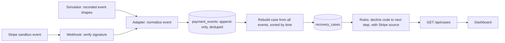

# FinFlow

Failed-payment triage for small subscription teams.

Stripe retries failed card payments on its own. FinFlow shows what is left
afterwards: which payments need a person, why they failed, and what to do
next. It only recommends. It never retries a charge, moves money, or contacts
customers.

**Status:** portfolio project built on Stripe test-mode events. Whether small
teams need this is not validated yet.

**Try it:** https://finflow-tpcu.onrender.com (free hosting: the first load can
take up to a minute while the service wakes up). On the Overview page, pick a
scenario, watch the case appear, and open it to see the next step, the rule
behind it, and the Stripe documentation it comes from.

## What is simulated and what is real

- **Deployed site:** simulated events, built from the shape of real Stripe
  sandbox events that I recorded. They go through the same adapter, event
  store, case rebuild and rules as a real webhook. Only the signature check is
  skipped.
- **Locally:** real, signed Stripe sandbox events delivered with the Stripe
  CLI, through the same pipeline.
- Live-mode events are rejected. There is no login. Demo data is shared by all
  visitors and resets when the service restarts.

## How it works



**Tradeoff.** Events are stored, and each case is derived from all of its
events in time order, instead of being updated one event at a time. Stripe does
not guarantee delivery order, and event timestamps have one-second precision,
so a late or scrambled event cannot corrupt a case. The cost is one rebuild per
event, which is fine at this scale. An attempt means an executed charge.

## Rules and evidence

Each rule cites Stripe's documentation:
[decline codes](https://docs.stripe.com/declines/codes),
[card declines and advice codes](https://docs.stripe.com/declines/card), and
[automatic retries](https://docs.stripe.com/billing/revenue-recovery/smart-retries).

Stripe's retry documentation lists the hard declines it will not retry
(`lost_card`, `stolen_card`, `authentication_required` and others). Those are
the cases where a person has to act, so they are the boundary of "needs a
person" in FinFlow. The rules encode documented guidance, not measured recovery
rates. A decline code with no rule goes to **Needs review** with no suggested
action. FinFlow does not guess. A few codes inherited from the original data
generator are not Stripe codes and are marked as legacy in `data/config.js`.

## Run it

Requires Node.js 22.13 or newer. `node:sqlite` is experimental in Node, so a
warning is expected.

```powershell
npm install
npm test
```

**Demo mode (simulator):**

```powershell
$env:DEMO_MODE="true"
npm run build
npm run server        # http://localhost:8787
```

**Real Stripe sandbox events, locally** (use three terminals):

```powershell
# 1. forward events and copy the whsec_... secret it prints
stripe listen --forward-to localhost:8787/webhook

# 2. run the server WITHOUT DEMO_MODE (demo mode switches the webhook off)
Remove-Item Env:DEMO_MODE -ErrorAction SilentlyContinue
$env:STRIPE_WEBHOOK_SECRET="whsec_..."
npm run build
npm run server

# 3. create a failing payment, fail it again, then succeed
stripe payment_intents create --amount=2000 --currency=usd --payment-method=pm_card_chargeDeclinedInsufficientFunds --confirm=true -d "automatic_payment_methods[enabled]=true" -d "automatic_payment_methods[allow_redirects]=never"
stripe payment_intents confirm pi_XXXX --payment-method=pm_card_chargeDeclined
stripe payment_intents confirm pi_XXXX --payment-method=pm_card_visa
```

Check the test payment-method names in
[Stripe's testing documentation](https://docs.stripe.com/testing). The Stripe
CLI fixture command `stripe trigger payment_intent.payment_failed` does not work
on every API version, so it is not used here.

| Variable | Meaning |
| --- | --- |
| `DEMO_MODE` | `true`: in-memory database, seeded cases, simulator routes, webhook off |
| `STRIPE_WEBHOOK_SECRET` | Signing secret for `/webhook`. Never use it in demo mode |
| `PORT` | Server port, default `8787` |
| `DATABASE_PATH` | SQLite file, default `data/finflow.sqlite` |
| `TRUST_PROXY_HOPS` | Trusted reverse proxies in front of the server, default `0`. Set `1` on Render |
| `NODE_VERSION` | Render only: pin the Node version you tested with |

**Deploy (Render):** build command `npm install; npm run build`, start command
`npm start`, environment `DEMO_MODE=true`, `TRUST_PROXY_HOPS=1` and
`NODE_VERSION`. Do not set any Stripe key.

## Limitations

- No login or multi-merchant support. Never run demo mode with real customer
  data or a real webhook secret.
- Missed webhooks are not backfilled from the Stripe API, so attempt counts can
  undercount.
- The retry schedule and subscription state (cancelled, paused) are unknown
  because invoice and subscription events are not ingested yet.
- Demo data is shared by all visitors and is lost when the service restarts.
- Follow-up tracking (contacted, assigned) is not built.

## Next steps

1. Login and per-merchant accounts, with live-mode support.
2. Backfill missed events from the Stripe API.
3. Invoice and subscription events: retry schedule, cancellation and pause.
4. A visitor-run sandbox, with a restricted test key and per-visitor limits.
5. Validate the need with small subscription teams.

## More detail

- [`docs/architecture-v2.md`](docs/architecture-v2.md): event model, storage,
  rebuild, rules, simulator and API.
- [`docs/archive/`](docs/archive): the original V1 planning documents, kept for
  history. They describe an earlier, broader scope.
